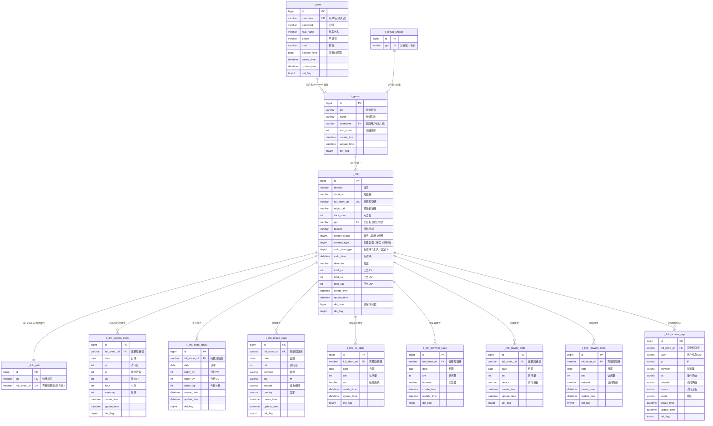

# 短链接项目数据库 ER 图

> 数据来源：`resources/database/link.sql` 建表脚本、各模块 `dao/entity` 实体类、ShardingSphere 分片配置
> 逻辑表共 **12 张**，物理表：`t_user` / `t_group` / `t_link` / `t_link_goto` 各 16 张分片表（HASH_MOD），统计/日志类表为单表。

## 一、整体 ER 图

## 二、关系与基数说明

| 关系 | 基数 | 关联键 | 说明 |
|---|---|---|---|
| t_user → t_group | 1:N | `username` | 一个用户可建多个分组；两表都按 username 做 HASH_MOD 分片，同用户落同一分片 |
| t_group_unique → t_group | 1:1 | `gid` | 全局不分片的 gid 发号表，`UNIQUE(gid)` 保证分组标识全局唯一 |
| t_group → t_link | 1:N | `gid` | 一个分组下多条短链；t_link 按 `gid` 分片 |
| t_link → t_link_goto | 1:1（逻辑）| `full_short_url` | goto 是**路由索引表**，按 `full_short_url` 分片；跳转时先用它定位 gid，再查对应 t_link 分片 |
| t_link → 8 张统计表 | 1:N | `full_short_url` | 每次访问写 1 条明细 + 7 张聚合表 `INSERT ... ON DUPLICATE KEY UPDATE` |

## 三、分片设计（ShardingSphere HASH_MOD，16 分片）

| 逻辑表 | 物理表 | 分片键 | 所属服务 | 设计原因 |
|---|---|---|---|---|
| `t_user` | t_user_0~15 | `username` | admin | 按用户水平拆分 |
| `t_group` | t_group_0~15 | `username` | admin / project | 跟随用户维度分片，同用户落同片 |
| `t_link` | t_link_0~15 | **`gid`** | project | 按分组水平拆分短链 |
| `t_link_goto` | t_link_goto_0~15 | **`full_short_url`** | project | 解决“跳转时只有短码、不知道 gid”的路由问题 |
| `t_group_unique` | 单表 | — | admin | 全局 gid 唯一约束，不分片 |
| 8 张 stats/logs 表 | 单表 | — | project | 统计/明细表不分片，靠 `full_short_url` 索引 |

**核心矛盾与解法**：跳转请求只带 `short_uri`，而 `t_link` 按 `gid` 分片，没有 gid 无法定位分片。
解法是多维护一张按 `full_short_url` 分片的 `t_link_goto` 路由表（仅 gid + full_short_url 两列）：
跳转时先查 goto 表拿 gid，再路由到正确的 t_link 分片。对应代码见
`project` 模块 `ShortLinkServiceImpl.restoreUrl()` 的两次 DB 查询。

## 四、各表唯一索引（聚合幂等关键）

| 表 | 唯一键 |
|---|---|
| t_user | `(username)` |
| t_group_unique | `(gid)` |
| t_link | `(full_short_url, del_time)` |
| t_link_access_stats | `(full_short_url, date, hour)` |
| t_link_stats_today | `(full_short_url, date)` |
| t_link_locale_stats | `(full_short_url, date, adcode, province)` |
| t_link_os_stats | `(full_short_url, date, os)` |
| t_link_browser_stats | `(full_short_url, date, browser)` |
| t_link_device_stats | `(full_short_url, date, device)` |
| t_link_network_stats | `(full_short_url, date, network)` |
| t_link_access_logs | 无（纯明细 INSERT，`idx_full_short_url` 普通索引）|

## 五、通用字段约定

- `id`：自增主键（bigint，雪花/自增）
- `create_time` / `update_time`：由 `MyMetaObjectHandler` 自动填充
- `del_flag`：逻辑删除标识（0 未删除 / 1 已删除）
- `t_user.deletion_time` / `t_link.del_time`：注销/删除时间戳，参与唯一索引实现"删除后可复用"（唯一键含时间戳，删除记录时间戳非 0）
